  

  
  
  
  
  

  🎯 <b>A curated index of production-ready Batch API Test Runners, Collection Runners, and High-Concurrency Load Testing Frameworks for REST, GraphQL, WebSocket, and gRPC.</b>

---

## 📌 Table of Contents

- [📖 Sector Overview & Market Dynamics](#-sector-overview--market-dynamics)
- [💼 SaaS & Enterprise Platforms](#-saas--enterprise-platforms)
- [🚀 Open-Source Test Runners & Frameworks](#-open-source-test-runners--frameworks)
- [⭐ Star History](#-star-history)
- [💖 Support & Contributing](#-support--contributing)

---

## 📖 Sector Overview & Market Dynamics

The global API testing and observability market is valued between **$1.6B and $3.5B**, projected to surge past **$6.0B to $16.0B** at an 18–23% CAGR. This exponential growth is catalyzed by microservices architecture sprawl, shift-left QA practices, and autonomous CI/CD pipelines.

The industry exhibits a **moderately fragmented** ecosystem at the developer and team tier due to a vibrant open-source ecosystem, alongside **moderate concentration** across enterprise deployments where budget consolidation favors scaled monitoring and full-lifecycle testing suites.

---

## 💼 SaaS & Enterprise Platforms

| Platform | Company Valuation / Revenue | Pricing | Free Tier Limit | Description |
|---|---|---|---|---|
| **Grafana Cloud k6** | Valuation: **$6.0B** (ARR: ~$600M) | Starting at **$19/month** (Grafana Cloud Pro platform fee + ~$0.15/VUh overages) | **500 Virtual User Hours (VUh)/month** forever; 10k active metrics series, 14-day test result retention | Managed cloud execution and distributed performance testing for k6 scripts. |
| **Postman** | Valuation: **$5.6B** (ARR: ~$171M–$313M) | Starting at **$14/user/month** (billed annually at $9/user/month for Solo, $19/user/month for Team) | **1 user**, **10,000 API calls/month**, up to 5 integrations, 50 Postbot AI credits | Industry-standard API client and automated collection runner (includes Newman CLI compatibility). |
| **BlazeMeter** | Revenue: **~$200M+** (Perforce Software) | Starting at **$99/month** (billed annually, or $149/mo billed monthly for Basic performance tier; API testing starts at $79/mo) | **50 concurrent virtual users**, **10 tests/month**, **20 min max duration**, 1 shared load generator, 1,000 API monitoring calls/month | Cloud load and API performance testing platform supporting JMeter, Taurus, and Selenium scripts. |

---

## 🚀 Open-Source Test Runners & Frameworks

*Repositories are sorted in descending order by GitHub stargazer count.*

| Tool | GitHub_Stars | License | Primary Focus | Description |
|---|---|---|---|---|
| **[Hoppscotch](https://github.com/hoppscotch/hoppscotch)** |  | AGPL-3.0 | Batch Collection & Testing | Lightweight, fast web-based API development ecosystem with built-in batch test runners and real-time protocol support. |
| **[Bruno](https://github.com/usebruno/bruno)** |  | MIT | Offline Collection Runner | Fast, Git-friendly open-source desktop client and CLI collection runner using plain-text Bru language. |
| **[Insomnia](https://github.com/Kong/insomnia)** |  | Apache-2.0 | API Design & Test Suite | Streamlined API client with robust test-suite automation, environment chaining, and Inso CLI runner for CI/CD. |
| **[k6](https://github.com/grafana/k6)** |  | AGPL-3.0 | Load & Performance Testing | Modern, developer-centric performance testing tool written in Go with expressive JavaScript scripting. |
| **[Locust](https://github.com/locustio/locust)** |  | MIT | Distributed Load Testing | Pythonic load testing framework where user behavior is defined completely in code with real-time web monitoring. |
| **[Vegeta](https://github.com/tsenart/vegeta)** |  | MIT | High-Throughput HTTP Stress | Ultra-fast HTTP load testing tool and library designed for constant request rate batch bombardment. |
| **[Apache JMeter](https://github.com/apache/jmeter)** |  | Apache-2.0 | Multi-Protocol Load Testing | Industry-standard 100% pure Java load and performance testing application with non-GUI batch execution modes. |
| **[Artillery](https://github.com/artilleryio/artillery)** |  | MPL-2.0 | Serverless & Cloud-Native Testing | Distributed, cloud-scale load and functional testing toolkit supporting HTTP, WebSocket, gRPC, and Playwright engine runs. |
| **[Karate](https://github.com/karatelabs/karate)** |  | MIT | Unified Test Automation | Unified framework combining batch API test-automation, mocks, performance testing, and UI automation in one syntax. |
| **[Newman](https://github.com/postmanlabs/newman)** |  | Apache-2.0 | CLI Collection Runner | Postman's headless CLI runner designed to execute API collections directly in terminal sessions and CI/CD pipelines. |
| **[REST Assured](https://github.com/rest-assured/rest-assured)** |  | Apache-2.0 | Java DSL Functional Testing | Fluent Java domain-specific language (DSL) making REST service validation and batch regression testing seamless. |
| **[Gatling](https://github.com/gatling/gatling)** |  | Apache-2.0 | Asynchronous Concurrency | High-performance load testing engine built on Akka/Netty with scenarios defined as code (Java, Kotlin, Scala, TS). |
| **[HttpRunner](https://github.com/httprunner/httprunner)** |  | Apache-2.0 | Declarative API Testing | Declarative API testing framework supporting YAML/JSON test cases, network recording, and pytest execution integration. |
| **[Tavern](https://github.com/taverntesting/tavern)** |  | Apache-2.0 | YAML Pytest Plugin | Command-line tool and pytest plugin for automated testing of RESTful and MQTT APIs using concise YAML specifications. |

---

## 📈 Star History

---

## 💖 Support & Contributing

Thank you for exploring **Awesome Batch API Test Runner**! 🎉 

If this curated repository saved you time or aided your API engineering and testing workflows, please consider:
- ⭐ **Starring** the repository on GitHub
- 🍴 **Forking** and contributing new tools, benchmarks, or guides
- 📢 **Sharing** this repository with your engineering team and developer circles

### ☕ Sponsor & Buy a Coffee
Support continued open-source curation and tool development:
👉 **[Sponsor on GitHub: https://github.com/sponsors/ishandutta2007](https://github.com/sponsors/ishandutta2007)** 💖
